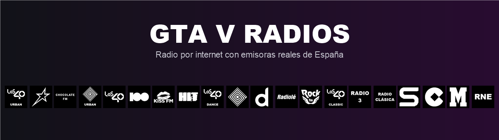

<div align="center">

[](#readme)

[](#requisitos "Requisitos")
[](https://github.com/scripthookvdotnet/scripthookvdotnet/releases "ScriptHookVDotNet")
[](https://github.com/naudio/NAudio "NAudio")
[](#compilar "Compilar")
[](#emisoras "Emisoras")
[](https://github.com/BunnyHoper/gtav-radios/commits "Historial")

</div>

GTA V Radios (RadioOnline) es un script para el modo historia de GTA V que reproduce **radio por internet** mientras vas en un vehículo. La radio del juego se apaga sola y en su lugar suenan emisoras reales de España: LOS40 Urban, Megastar, Chocolate FM y más.

* [INSTALACIÓN](#instalación)
    * [Archivos](#archivos)
    * [Requisitos](#requisitos)
    * [Compilar](#compilar)
* [USO](#uso)
    * [Controles](#controles)
* [EMISORAS](#emisoras)
    * [Añadir emisoras](#añadir-emisoras)
* [CONFIGURACIÓN](#configuración)
* [PROBLEMAS](#problemas)


# INSTALACIÓN

Copia los dos archivos de la carpeta [`scripts`](scripts) a la carpeta `scripts` del juego (junto a `GTA5.exe`). Si no existe, créala.

## Archivos

Archivo|Descripción
:---|:---
[`scripts/RadioOnline.dll`](scripts/RadioOnline.dll)|El script, ya compilado
[`scripts/RadioOnline.ini`](scripts/RadioOnline.ini)|Emisoras, teclas y volumen
[`src/RadioOnline.cs`](src/RadioOnline.cs)|Código fuente
[`build.ps1`](build.ps1)|Script para compilar

## Requisitos

* [ScriptHookV](http://www.dev-c.com/gtav/scripthookv/) para tu versión del juego
* [ScriptHookVDotNet 3](https://github.com/scripthookvdotnet/scripthookvdotnet/releases): probado con la **3.7.0 nightly** en la build **3889**
* `NAudio.dll` **1.10** en la carpeta `scripts` (lo trae, por ejemplo, ExtendedLSC)
* .NET Framework 4.8 (ya viene con Windows 10/11)

## Compilar

Con el compilador de .NET Framework que trae Windows; no hace falta Visual Studio:

```powershell
.\build.ps1 -Game "E:\Grand Theft Auto V Legacy"
```

El resultado se guarda en `scripts\RadioOnline.dll`.


# USO

Sube a cualquier vehículo: la radio online arranca sola, apaga la del juego y muestra la emisora en pantalla. Al bajarte, se para.

## Controles

Tecla|Acción
:---|:---
<kbd>Inicio</kbd>|Encender / apagar la radio online
<kbd>RePág</kbd>|Emisora siguiente
<kbd>AvPág</kbd>|Emisora anterior
<kbd>+</kbd> (teclado numérico)|Subir volumen
<kbd>-</kbd> (teclado numérico)|Bajar volumen

Todas se pueden cambiar en `RadioOnline.ini`. Ninguna usa F1–F10 ni las flechas, para no chocar con otros mods.


# EMISORAS

\#|Emisora|Género
:---:|:---|:---
1|LOS40 Urban|Urbano / reggaetón
2|LOS40 (Anda Ya)|Éxitos
3|LOS40 Dance|Dance
4|Megastar FM|Urbano / éxitos
5|Hit FM|Éxitos
6|Kiss FM|Éxitos
7|Cadena 100|Éxitos
8|Cadena Dial|Música en español
9|Chocolate FM|Reggaetón
10|Loca FM Urban|Urbano

## Añadir emisoras

En `RadioOnline.ini`, sección `[STATIONS]`, una línea por emisora con el formato `Nombre|URL`:

```ini
Station11=Mi emisora|https://servidor/stream.mp3
```

> [!NOTE]
> Solo funcionan streams **MP3** directos (no `.m3u8` ni AAC).


# CONFIGURACIÓN

```ini
[KEYS]
Toggle=Home        ; encender / apagar
Next=PageUp        ; siguiente
Previous=PageDown  ; anterior
VolumeUp=Add       ; + del teclado numérico
VolumeDown=Subtract

[SETTINGS]
Volume=60          ; volumen inicial 0-100
StartEnabled=true  ; arranca encendida al subir al coche
```

Los nombres de tecla son los de .NET (`Home`, `End`, `PageUp`, `Add`, `NumPad5`…).


# PROBLEMAS

* **«No se pudo conectar»**: el aviso rojo muestra el motivo entre paréntesis y el detalle completo queda en `%TEMP%\RadioOnline.log`.
* **No suena nada y no sale ningún aviso**: revisa `ScriptHookVDotNet.log` en la carpeta del juego y comprueba que `NAudio.dll` está en `scripts`.
* **Las URL con `:` no se leen**: el script lee las emisoras directamente del `.ini`, así que no uses otro lector de ajustes para ellas.
